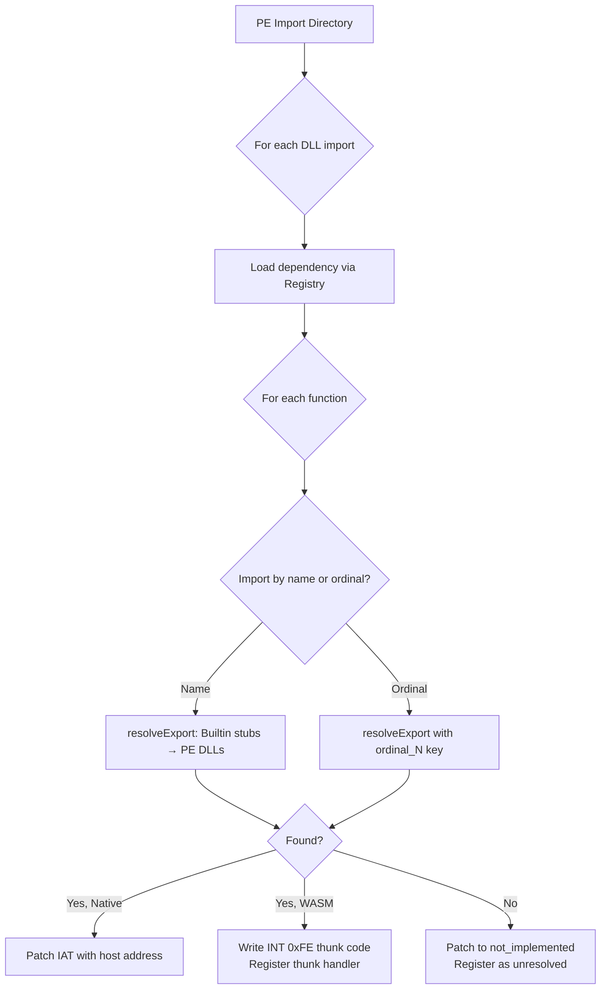
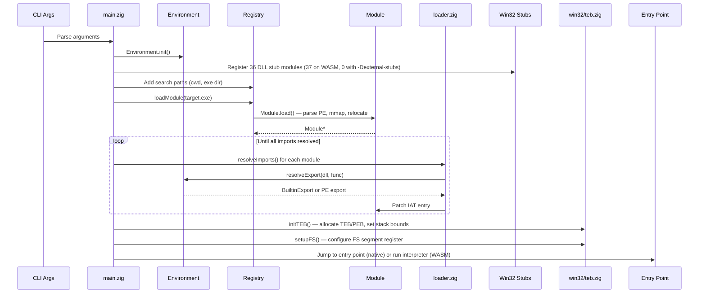

# Zine Architecture

Zine is a Win32 PE (Portable Executable) emulator written in Zig that runs 32-bit Windows executables on Linux, both natively (x86/x86_64) and in the browser via WebAssembly. It loads PE files, resolves imports against a library of built-in Win32 API (Application Programming Interface) stubs, and renders GUI (Graphical User Interface) applications through a WebSocket-based frontend.

## High-Level Overview

```
┌─────────────────────────────────────────────────────────────┐
│                       CLI / Entry                           │
│         main.zig (native) │ wasm_main.zig (WASM/WebAssembly)│
└──────────────┬──────────────────┴───────────┬───────────────┘
               │                              │
       ┌───────▼───────────────┐      ┌───────▼───────┐
       │    Native Path        │      │   WASM Path   │
       │                       │      │ x86 Software  │
       │ Default: Direct x86   │      │ Interpreter   │
       │ execution (mmap+jump) │      │ (always)      │
       │                       │      │               │
       │ --interpret: x86      │      │               │
       │ Software Interpreter  │      │               │
       └───────┬───────────────┘      └───────┬───────┘
               │                              │
       ┌───────▼──────────────────────────────▼───────┐
       │              Shared Core                      │
       │  ┌─────────┐  ┌──────────┐  ┌─────────────┐ │
       │  │PE Parser │  │  Loader  │  │ Win32 Stubs │ │
       │  │ pe.zig   │  │loader/*  │  │  win32/*    │ │
       │  └─────────┘  └──────────┘  └─────────────┘ │
       │  ┌─────────┐  ┌──────────┐  ┌─────────────┐ │
       │  │  TEB/PEB │  │ Platform │  │ GUI/Renderer│ │
       │  │win32/teb │  │platform/*│  │   gui/*     │ │
       │  └─────────┘  └──────────┘  └─────────────┘ │
       └──────────────────────────────────────────────┘
```

## Build Targets

The build system (`build.zig`) supports four target architectures:

| Target | Architecture | Description |
|--------|-------------|-------------|
| **x86** (default) | `i386-linux` | Native 32-bit execution. Sets image base to `0x70000000` so the low address space (`0x00400000+`) is free for guest PEs — the same approach Wine uses. Disables SSE/AVX (Streaming SIMD Extensions / Advanced Vector Extensions) to match legacy MSVC6 (Microsoft Visual C++ 6.0) expectations. |
| **x86_64** | `x86_64-linux` | Native 64-bit host running 32-bit PEs in CPU compatibility mode (CS=0x23). API calls use `INT 0xFE` → SIGSEGV signal dispatch to call 64-bit Zig stubs. All guest memory is in the low 4GB via `MAP_32BIT`. |
| **wasm32** | `wasm32-wasi` | WASM (WebAssembly) output, running under a WASI (WebAssembly System Interface) runtime. All x86 code is run through the software interpreter. Initial memory is 256 MB, max 2 GB. |
| **wasm64** | `wasm64-wasi` | Experimental 64-bit WASM output of the same WASI entry point (`wasm_main.zig`). Same interpreter path as wasm32; not covered by the test suites. |

---

## Subsystems

### 1. Entry Points

**Native** — [`src/main.zig`](../src/main.zig)

The native entry point handles:
- CLI (Command Line Interface) argument parsing:
  - `-t`, `--trace` — enable all tracing (API + instructions)
  - `--trace-api` — enable API call tracing only
  - `--trace-insn` — enable x86 instruction tracing only
  - `-i`, `--interpret` — use x86 software interpreter
  - `--jit` — use JIT compiler (x86-to-WASM translation)
  - `--profile` — enable profiling (hot code pages, opcodes, stub calls)
  - `-q`, `--quiet` — report only warnings and errors on stderr
  - `--argv0 <name>` — override argv[0] passed to the target
  - `--fltk` — use native FLTK GUI instead of web UI
  - `--no-gui` — disable GUI (no web server), even for GUI subsystem apps
  - `-h`, `--help` — show help
  - `-v`, `--version` — show version
  - `--` — end of zine options (allows target names starting with `-`)
  - Environment variables: `ZINE_LOG_LEVEL` (log level), `ZINE_TRACE` (API tracing), `ZINE_TRACE_INSN` (instruction tracing), `ZINE_PROFILE` (profiling), `ZINE_WEB_HOST` / `ZINE_WEB_PORT` (web UI bind address), `ZINE_VIRTUAL_CLOCK_NS` / `ZINE_CLOCK_STEP_NS` (virtual guest clock)
- `.bat`/`.cmd` file preprocessing via `bat.zig`
- SIGSEGV/SIGFPE (segmentation fault / floating-point exception) signal handler for SEH (Structured Exception Handling) dispatch and AppCompat (Application Compatibility) shims
- Environment setup (combining BAT-defined PATH, argv, envp)
- Module loading and import resolution
- GUI subsystem detection (checking PE subsystem field for `IMAGE_SUBSYSTEM_WINDOWS_GUI`)
- Three execution modes: **direct native execution** (default, jump to entry point), **software interpreter** (`--interpret`), or **JIT compiler** (`--jit`, x86-to-WASM translation)

**WASM** — [`src/wasm_main.zig`](../src/wasm_main.zig)

The WASM entry point runs under a WASI runtime (e.g. wasmtime). It always uses the software interpreter since there is no way to directly execute x86 machine code in WebAssembly. It allocates a combined memory buffer laid out as `[PE image] [stack (64 KB)] [thunks (32 KB)] [heap (512 MB)]`, keeping thunks in a separate region beyond the PE's `SizeOfImage` so they don't overwrite import tables or data sections.

---

### 2. PE Parser

[`src/pe.zig`](../src/pe.zig) · [`src/pe_resources.zig`](../src/pe_resources.zig)

Defines all PE/COFF (Common Object File Format) data structures (`IMAGE_DOS_HEADER`, `IMAGE_NT_HEADERS32`, `IMAGE_SECTION_HEADER`, etc.) and provides the `PEParser` struct for parsing PE files from raw byte buffers. The parser validates the MZ (Mark Zbikowski, the DOS signature `0x5A4D`) and PE signatures, extracts section headers, and provides accessors for the DOS header, NT headers, and sections.

The resource module handles the three-level resource directory tree (Type → Name → Language) used by `Module.getResource()` to extract icons, menus, dialogs, and other embedded resources.

---

### 3. Module Loader

[`src/loader/`](../src/loader/)

The loader subsystem consists of four core modules and three resource parsers:

| Module | Responsibility |
|--------|---------------|
| [module.zig](../src/loader/module.zig) | Loads a PE file from disk, maps it into memory via `platform.mmap`, copies section data, and applies base relocations if the image was loaded at a non-preferred address. |
| [registry.zig](../src/loader/registry.zig) | Maintains a name → `Module*` mapping and search path list. Handles DLL (Dynamic Link Library) search order. `modulesInLoadOrder` and `findModuleByName` read the insertion-ordered list rather than the map, so import resolution and a name two modules share resolve the same way on every run. |
| [env.zig](../src/loader/env.zig) | The `Environment` struct ties together the module registry and built-in stub exports. Provides `resolveExport()` which first checks built-in stubs (our verified implementations), then falls back to PE DLLs loaded from disk. Also contains `addBuiltinExportComptime()`, which registers a comptime thunk handler as a builtin export and picks the cdecl calling convention for the `MSVCRT.dll` and `MSVCP*` modules. |
| [loader.zig](../src/loader/loader.zig) | Walks the PE import directory, resolves each function by name or ordinal, and patches the IAT (Import Address Table). On native targets, writes host function addresses directly. On WASM, allocates `INT 0xFE` thunk stubs in guest memory. The `DllMain` (`DLL_PROCESS_ATTACH`) call for a loaded PE DLL belongs to KERNEL32's `LoadLibraryA` path ([kernel32/process.zig](../src/win32/kernel32/process.zig)), not here. |

#### Import Resolution Flow



---

### 4. x86 Emulation Engine

[`src/x86/`](../src/x86/)

The software interpreter is used on WASM (always) and optionally on native (`--interpret`).

| Module | Responsibility |
|--------|---------------|
| [cpu.zig](../src/x86/cpu.zig) | CPU state: 8 GPRs (General Purpose Registers: EAX, ECX, EDX, EBX, ESP, EBP, ESI, EDI), EIP (Extended Instruction Pointer), segment registers, lazy EFLAGS (CPU status flags register), FPU (Floating Point Unit) state, and guest memory reference. Provides inline typed accessors for 8/16/32-bit register operations and stack push/pop. |
| [decoder.zig](../src/x86/decoder.zig) | Instruction decoder. Reads opcode bytes, prefixes, ModR/M (addressing mode byte), SIB (Scale-Index-Base byte), displacement, and immediates from the code stream. Produces a compact `Instruction` struct (~28 bytes) using flat `OpKind`/register/memory fields instead of tagged unions, optimized for cache-friendly decode caching. |
| [decode_cache.zig](../src/x86/decode_cache.zig) | Instruction decode cache (inspired by Blink's `OpCache`). A 1024-entry hash-indexed cache that maps guest EIP addresses to previously decoded instructions, eliminating redundant decoding in loops. Validated by EIP tag, fetch length, and every fetched byte. |
| [execute.zig](../src/x86/execute.zig) | The main interpreter loop. Fetches, decodes (via decode cache), and executes x86 instructions. Features branch fusion — short Jcc (0x70–0x7F) and near Jcc (0F 80–8F) instructions following flag-setting ops are executed inline, saving a full decode/dispatch cycle. All hot-path helper functions (readOperand, writeOperand, computeEffectiveAddress) are marked `inline`. Dispatches `INT 0xFE` to the thunk table. Delegates FPU operations to `fpu.zig`. |
| [sse.zig](../src/x86/sse.zig) | SSE/SSE2/MMX instruction execution. Handles all SIMD instructions dispatched from `execute.zig`. Prefix byte determines variant (none=PS/MMX, 66=PD/XMM integer, F3=SS, F2=SD). |
| [flags.zig](../src/x86/flags.zig) | Lazy EFLAGS computation. Defers CF (Carry), ZF (Zero), SF (Sign), OF (Overflow), PF (Parity) flag calculations until read, recording the operation type and operands. |
| [fpu.zig](../src/x86/fpu.zig) | x87 FPU state (ST(0)–ST(7) floating-point register stack, control/status words). |
| [memory.zig](../src/x86/memory.zig) | `GuestMemory` struct — translates guest virtual addresses to host buffer offsets. Provides inline `read8/16/32`, `write8/16/32`, and `readSlice`/`writeSlice`. Supports `native_linear` mode for direct host memory access when using `--interpret` on native targets. |
| [thunks.zig](../src/x86/thunks.zig) | Thunk dispatch table. Maps thunk IDs to handlers. On `INT 0xFE`, reads the 4-byte thunk ID from the code stream and calls the registered handler with the CPU state. Also manages the native import registry for stdcall (callee-cleans-stack calling convention) parameter cleanup. |
| [compat_thunks.zig](../src/x86/compat_thunks.zig) | x86_64 compatibility mode thunk pool. Allocates `INT 0xFE` stubs in a 256KB executable pool in the low 4GB (`MAP_32BIT`). When the SIGSEGV handler detects `CD FE`, `dispatchFromSignal()` reads 32-bit args from the guest stack, calls 64-bit Zig stubs, and writes results back via ucontext. Also provides `enterCompatMode()` which uses `iretq` to switch CS to 0x23 and start the PE. |

#### Thunk Mechanism (WASM & x86_64 Compat Mode)

On WASM and x86_64, Win32 API calls can't be dispatched by jumping to native function pointers directly. Instead, both use the same `INT 0xFE + thunk_id` mechanism:

1. During import resolution, each stub gets a thunk slot written into guest memory: `CD FE` (`INT 0xFE`, a software interrupt) followed by a 4-byte thunk ID.
2. The PE's IAT is patched to point to this thunk code.
3. When the guest x86 code executes `CALL [IAT_entry]`, it jumps to the thunk.
4. **WASM**: The interpreter's `INT 0xFE` handler reads the thunk ID and dispatches to the registered Zig function.
   **x86_64**: `INT 0xFE` in 32-bit compat mode (CS=0x23) triggers SIGSEGV. The signal handler detects `CD FE` at the faulting IP, reads the thunk ID, and calls `compat_thunks.dispatchFromSignal()` which marshals 32-bit args from the guest stack (via RSP in ucontext), calls the 64-bit Zig stub, writes the return value to RAX, adjusts RSP for stdcall, and sets RIP to the return address.
5. The handler reads arguments from the guest stack, calls the stub function, writes the return value to EAX (the accumulator register, used for return values), and adjusts ESP (the stack pointer register) for stdcall cleanup.

> **Note (WASM):** Thunks are allocated in a dedicated region *beyond* the PE image and stack in WASM's combined buffer; the region sizes are in [`MEMORY_LAYOUT.md`](MEMORY_LAYOUT.md). An earlier design placed thunks inside `SizeOfImage`, which overwrote the IAT and data sections with `0xCC` (INT3), causing crashes.

> **Note (x86_64):** Thunks are allocated in a 256KB executable pool mapped with `MAP_32BIT` to ensure addresses fit in 32-bit IAT slots. Each API call costs one kernel signal entry/exit (~2-5µs), acceptable for I/O-bound CLI tools like MSVC.

---

### 5. Win32 API Stubs

[`src/win32/`](../src/win32/)

Zine implements 37 DLL stub modules that provide Win32 API compatibility: 36 registered on every target, plus `mspdb60` (WASM only), for 37 in total. `rcdll` is registered on every target because the real RCDLL.DLL fails to compile DIALOG templates on native. Each module exports a `register()` function that adds its exports to the `Environment`. Unresolved functions fall back to `not_implemented`, which prints a diagnostic and exits.

| Category | Stubs |
|----------|-------|
| **CRT (C Runtime)** | `msvcrt.zig` (argc/argv/envp, malloc/free, stdio, string functions) |
| **Kernel** | `kernel32.zig` (process, memory, file I/O, heap, threading, registry), `ntdll.zig` (NT system information queries) |
| **User Interface** | `user32.zig`, `comctl32.zig`, `comdlg32.zig`, `shell32.zig` |
| **Graphics** | `gdi32.zig` (GDI — Graphics Device Interface), `ddraw.zig` (DirectDraw), `d3d7/d3d7.zig` (Direct3D 3/7 interfaces reached via DirectDraw's `QueryInterface`, with a software rasterizer), `d3d8.zig` (Direct3D 8), `display_surface.zig` (the primary surface and display mode that ddraw and d3d7 present through) |
| **Audio/Input** | `dsound.zig` (DirectSound), `winmm.zig` (Windows Multimedia), `dinput.zig` (DirectInput), `dinput8.zig` (DirectInput8), `mss32.zig` (Miles Sound System) |
| **Security/RPC** | `advapi32.zig`, `rpcrt4.zig` (RPC — Remote Procedure Call), `ole32.zig` (OLE — Object Linking and Embedding), `oleaut32.zig` (OLE Automation) |
| **Networking** | `wsock32.zig`, `ws2_32.zig`, `icmp.zig` |
| **Other** | `imm32.zig`, `version.zig`, `winspool.zig`, `setupapi.zig`, `shlwapi.zig`, `msvcp60.zig`, `mpr.zig`, `nddeapi.zig`, `imagehlp.zig`, `mfc42.zig`, `cards.zig`, `vdmdbg.zig`, `mag_hook.zig`, `rcdll.zig`; `mspdb60.zig` (WASM-only) |

#### Calling Convention

[`src/win32/calling_convention.zig`](../src/win32/calling_convention.zig) defines `WINAPI` as `.winapi` on x86/x86_64 (stdcall on 32-bit, Win64 on 64-bit) or `.c` on all other targets (WASM, ARM, etc.), abstracting the stdcall (callee pops arguments) vs. cdecl (caller pops arguments) calling convention difference across platforms.

---

### 6. TEB (Thread Environment Block) / PEB (Process Environment Block) and the FS Segment Register

[`src/win32/teb_layout.zig`](../src/win32/teb_layout.zig) holds the structure layouts (`TEB`, `PEB`, `NT_TIB`, `CONTEXT`, `EXCEPTION_RECORD`, ...) and the host-visible TEB globals (`teb_address`, `teb_fs_selector`, `teb_base_addr`). It imports nothing but `std`, because the host signal handler in `src/platform/native.zig` reads and writes those globals: a layout module that reached back into `src/platform.zig` would close an import cycle. [`src/win32/teb.zig`](../src/win32/teb.zig) owns the allocation and FS-segment setup that do need the platform layer.

#### What is the FS segment register?

The x86 architecture has six **segment registers** — CS, DS, ES, SS, FS, and GS. In the original 16-bit 8086, segments were essential for addressing memory beyond 64 KB. In 32-bit protected mode, most segments (CS, DS, ES, SS) use a **flat memory model** with a base address of 0, making segmentation effectively transparent.

However, FS and GS remain useful because the OS can set their **base addresses** to point to per-thread data structures without affecting normal memory addressing. Windows NT uses **FS** for this purpose: every thread has its own FS base pointing to its own Thread Environment Block (TEB). This means any instruction like `mov eax, [fs:0x30]` reads from the TEB at offset 0x30 — a fast, register-based access without needing a global variable or function call.

Win32 code — including MSVC (Microsoft Visual C++) compiled programs and system DLLs — relies on FS-relative accesses extensively:

| Access | Offset | TEB Field | Used By |
|--------|--------|-----------|---------|
| `FS:[0x00]` | 0x00 | `ExceptionList` | SEH (Structured Exception Handling) chain head |
| `FS:[0x04]` | 0x04 | `StackBase` | Stack overflow detection (MSVC `_chkstk`) |
| `FS:[0x08]` | 0x08 | `StackLimit` | Stack overflow detection |
| `FS:[0x18]` | 0x18 | `Self` | TEB self-pointer (`NtCurrentTeb()`) |
| `FS:[0x20]` | 0x20 | `ClientId.UniqueProcess` | `GetCurrentProcessId()` |
| `FS:[0x24]` | 0x24 | `ClientId.UniqueThread` | `GetCurrentThreadId()` |
| `FS:[0x30]` | 0x30 | `ProcessEnvironmentBlock` | PEB pointer (heap, image base, params) |
| `FS:[0x34]` | 0x34 | `LastErrorValue` | `GetLastError()` / `SetLastError()` |

#### TEB/PEB Initialization

Zine allocates a page-aligned TEB struct, populates the critical fields, and creates a PEB with `RTL_USER_PROCESS_PARAMETERS` (command line, environment block in UTF-16, current directory). The `StackBase` and `StackLimit` are read from the host process's actual stack bounds, which is critical because MSVC compilers (e.g. `cl.exe` / `c1.dll`) check these fields to detect stack overflow and will abort with error C1063 if they are zero.

#### Configuring FS on Each Platform

| Platform | Mechanism | Details |
|----------|-----------|---------|
| **Native x86 (32-bit)** | `set_thread_area` syscall | Allocates a GDT (Global Descriptor Table) entry via syscall 243 (`__NR_set_thread_area`), sets its base address to the TEB, and loads the resulting selector into the FS register. |
| **Native x86_64 (64-bit)** | `arch_prctl(ARCH_SET_FS, ...)` | On 64-bit Linux, `arch_prctl` with `ARCH_SET_FS` (0x1002) sets the FS base directly. Since 32-bit code running under a 64-bit kernel still uses FS for TEB access, this configures the base address the CPU uses when resolving FS-relative addresses. |
| **WASM (interpreter)** | `cpu.fs_base` field | No hardware segment support exists. The interpreter's `resolveSegmentAddress(.fs, offset)` adds `cpu.fs_base + offset` to compute the effective address. The FS base is set to the TEB pointer during CPU initialization. |

---

### 7. Platform Abstraction

[`src/platform.zig`](../src/platform.zig) · [`src/platform/`](../src/platform/)

A comptime-selected backend that abstracts OS-specific functionality:

| API | Native (`native.zig`) | WASM (`wasm.zig`) |
|-----|----------------------|-------------------|
| `mmap`/`munmap` | Linux `mmap`/`munmap` syscalls | Zig allocator (page-aligned) |
| `setupFS` | `arch_prctl(ARCH_SET_FS)` or `set_thread_area` | No-op (interpreter uses `cpu.fs_base`) |
| `spawnThread` | `std.Thread.spawn` | Stub (single-threaded) |
| `yield`/`sleep`/`Mutex` | `std.Thread` primitives | No-ops / no-op mutex |
| `readExceptionList` | Reads `FS:0` (SEH chain head) on x86 | Returns `0xFFFFFFFF` |
| `getProcessId` | Host PID | Fixed constant |
| `getStackBounds` | Reads `/proc/self/maps` | Returns zeros (not available on WASM) |
| `installSegfaultHandler` | `sigaction(SIGSEGV, SIGFPE, SIGILL)` | No-op |
| `mapNullPage` | `mmap` at address 0 | No-op |
| `raiseStackLimit` | Raises `RLIMIT_STACK` to its hard limit | No-op |
| `exitProcess` | `std.process.exit` | `std.process.exit` |
| `timestamp` | `std.time.timestamp` (epoch seconds) | Returns 0 |
| `mprotect`/`mprotectExec` | Linux `mprotect` | No-op |
| `pipe`/`dup` | Linux `pipe2`/`dup` | Returns error |

---

### 8. GUI / Renderer

[`src/gui/`](../src/gui/)

The GUI subsystem presents Win32 GUI applications in a web browser (web backend) or in a native FLTK window (FLTK backend, see [`FLTK_PLAN.md`](FLTK_PLAN.md)). Both are reached through one shared command surface in `renderer.zig`; the diagram below shows the web path.

#### Backend Architecture

```
┌─────────────────────────┐
│   Win32 Stubs           │   user32: CreateWindow, SetWindowText, ...
│  (ddraw, gdi32, d3d8)   │   ddraw/d3d8: framebuffer writes
└───────────┬─────────────┘
            │ writes to
            ▼
┌─────────────────────────┐
│    renderer.zig          │   Framebuffer (BGRA — Blue/Green/Red/Alpha)
│    Shared API surface    │   Fixed 4 MB surface (1024×1024 pixels);
│                          │   up to 4096 per axis, scaled down to fit
│                          │   State caching (menu, title, dialogs, audio)
└───────────┬─────────────┘
            │ delegates to
            ▼
┌─────────────────────────┐
│    web_ui.zig            │   HTTP (Hypertext Transfer Protocol) server
│    WebSocket transport   │   on ZINE_WEB_HOST:ZINE_WEB_PORT
│                          │   Serves static files from src/gui/
│                          │   Pushes frames + JSON (JavaScript Object Notation)
└───────────┬─────────────┘
            │ WebSocket
            ▼
┌─────────────────────────┐
│    Browser Frontend      │   index.html + app.js + win2k.css
│    Canvas + Win2K theme  │   Renders framebuffer on <canvas>
│    (win2k.css)           │   Renders menus, dialogs, controls
│                          │   Web Audio API for sound playback
└─────────────────────────┘
```

- **Framebuffer**: The renderer maintains a shared BGRA framebuffer (Blue, Green, Red, Alpha byte order). DirectDraw/D3D8 surface locks write pixel data here. Frames are pushed to connected browsers whenever the guest marks the screen dirty, over WebSocket binary messages; the frontend schedules presentation with `requestAnimationFrame`.
- **JSON Messages**: Window chrome (title, menus, dialogs, status bar, controls) is sent as JSON text messages. The frontend renders them using a Windows 2000 CSS (Cascading Style Sheets) theme.
- **Input**: Browser keyboard/mouse events are sent back as JSON and dispatched to Win32 stub callbacks.
- **Audio**: Audio samples are pushed as binary WebSocket messages with an `AUD` prefix. The browser plays them via the Web Audio API.
- **Reconnection**: The renderer caches the latest state (resolution, menu, title, dialogs, controls) and replays it to newly connected clients.
- **Static assets**: Native builds embed gzip-compressed HTML, CSS, and JavaScript at build time. HTTP responses negotiate gzip using `Accept-Encoding`, carry representation-specific ETags and `Vary: Accept-Encoding`, and require revalidation. Files are still read from `src/gui/`; a content digest mismatch falls back to the current uncompressed file so edits cannot serve stale compressed bytes. The HTTP routes, status codes, and JSON message types are specified in [`WEB_UI_PROTOCOL.md`](WEB_UI_PROTOCOL.md).

---

### 9. Signal Handling & SEH (Native)

On native targets, Zine installs a `SIGSEGV`/`SIGFPE`/`SIGILL` handler that implements:

1. **SIGFPE recovery**: Skip divide-by-zero instructions in game code, clear result registers.
2. **Bad function pointer recovery**: When EIP (the instruction pointer) is in an invalid range, walk the stack to find a plausible return address in app code and redirect execution there.
3. **NULL pointer AppCompat shims**: Detect common NULL-pointer dereference patterns (`mov [eax], ...` where EAX=0) and skip the instruction, matching Windows behavior for some buggy games.
4. **SEH dispatch**: Read the exception chain from `FS:0`, build `EXCEPTION_RECORD` + `CONTEXT` structs, and walk the handler chain. Supports `ExceptionContinueExecution` and `ExceptionContinueSearch` dispositions.

`SetUnhandledExceptionFilter` records the guest's handler pointer but nothing invokes it: an exception that escapes the chain prints `Unhandled exception, terminating.` and exits.

---

### 10. Auxiliary Modules

| Module | Path | Purpose |
|--------|------|---------|
| **runner.zig** | [`src/runner.zig`](../src/runner.zig) | Shared PE loading and execution pipeline used by both native and WASM entry points. Handles stub registration, search path setup, import resolution, basic block scanning, and the JIT execution loop. |
| **runtime.zig** | [`src/runtime.zig`](../src/runtime.zig) | Process-global singletons (`std.Io`, allocator, environment, main-exe dir) for code that cannot take parameters: Win32 stubs called from guest code, signal handlers, and thunks. Also the seam the guest's time passes through: `installVirtualClock` swaps the wall and monotonic readings for a fixed cursor (`ZINE_VIRTUAL_CLOCK_NS`), `pauseOrAdvance` charges a guest wait or a host-waiting poll to that cursor instead of blocking the host, and `hostMonoNanoTimestamp` keeps emulator instrumentation on the real clock. |
| **bat.zig** | [`src/bat.zig`](../src/bat.zig) | Parses `.bat`/`.cmd` launcher scripts, expands `%VARIABLE%` references, and extracts the final command to execute. |
| **log.zig** | [`src/log.zig`](../src/log.zig) | Structured diagnostic logging with colored level prefixes (`[FATAL]`, `[ERROR]`, `[WARN]`, `[INFO]`, `[TRACE]`). Auto-detects TTY for color; respects `NO_COLOR` env var. Redacts the host home directory (`HOME`/`USERPROFILE`) from every record, and `redactEnvValue` withholds the value of the identity variables (`USER`, `USERNAME`, `LOGNAME`, `EMAIL`) from environment traces. |
| **config.zig** | [`src/config.zig`](../src/config.zig) | Runtime configuration read from `ZINE_*` environment variables at startup. Validates each value before use and exits with status 2 on a rejected one. Owns the web UI bind address (`ZINE_WEB_HOST`, `ZINE_WEB_PORT`), the URL printed at startup, the CSP `connect-src` origin, and the WebSocket origin allowlist. Also parses the guest clock settings (`ZINE_VIRTUAL_CLOCK_NS`, `ZINE_CLOCK_STEP_NS`) that `main` hands to `runtime.installVirtualClock`. |
| **trace.zig** | [`src/trace.zig`](../src/trace.zig) | Conditional debug printing. Activated by `--trace`, `--trace-api`, `--trace-insn` flags or `ZINE_TRACE`/`ZINE_TRACE_INSN` environment variables. |
| **profiler.zig** | [`src/profiler.zig`](../src/profiler.zig) | Lightweight profiling: EIP heat map (per-4KB page), opcode frequency table, and stub call counters. Activated by `--profile` flag or `ZINE_PROFILE` environment variable. |
| **path_utils.zig** | [`src/path_utils.zig`](../src/path_utils.zig) | Converts between POSIX and Win32 paths (`drive_c/... ↔ C:\...`). |
| **platform.zig** | [`src/platform.zig`](../src/platform.zig) | Native and WASM backends for memory, threading, and process services. `guest_process_id` is the fixed id `GetCurrentProcessId` reports on every backend, so guest output does not carry the host's pid. |

---

## Memory Layout (Native x86)

```
0x00000000 ┌──────────────────────┐
           │ Mapped NULL page     │ ← AppCompat: allows controlled NULL derefs
0x00001000 ├──────────────────────┤
           │                      │
0x00400000 ├──────────────────────┤
           │ Guest PE image       │ ← PE loaded at its preferred ImageBase
           │ (.text, .data, etc.) │
           │ Import Address Table │ ← Patched with host stub addresses
0x00700000 ├──────────────────────┤
           │                      │
0x70000000 ├──────────────────────┤
           │ Zine host binary     │ ← Placed high to avoid collision with guest PEs
           │                      │
           └──────────────────────┘
```

On WASM, the interpreter operates on a single combined buffer allocated at startup:

```
preferred_base
     │
     ▼
     ┌──────────────────────┐
     │ PE image (SizeOfImage)│ ← Copied from the loaded PE; sections fully preserved
     │ .text, .data, .rdata │
     │ Import Address Table │ ← Patched with thunk addresses (not host pointers)
     ├──────────────────────┤
     │ Stack (64 KB)        │ ← ESP starts near the top of this region
     ├──────────────────────┤
     │ Thunks (32 KB)       │ ← INT 0xFE stubs (CD FE + 4-byte ID), filled with 0xCC
     ├──────────────────────┤
     │ Heap (512 MB)       │ ← Guest heap for VirtualAlloc, HeapAlloc, malloc, etc.
     └──────────────────────┘
```

The `GuestMemory.base_addr` is set to the PE's preferred `ImageBase` from the Optional Header, so all absolute addresses in guest x86 code resolve correctly.

---

## Data Flow: Startup Sequence



---

## Testing

The build system includes a `test` step that runs embedded unit tests in the x86 interpreter modules:

```bash
zig build test
```

Tested modules (see `src/test_root.zig` for the authoritative list): `x86/{flags,memory,fpu,cpu,decoder,decode_cache,execute,sse,thunks}.zig`, `jit/compiler.zig`, `loader/{menu_parser,module,registry,loader}.zig`, `fuzz/replay.zig`, `profiler.zig`, `config.zig`, `runtime.zig`, `log.zig`, `path_utils.zig`, `bat.zig`, `pe.zig`, `runner.zig`, `gui/web_ui.zig`, and the `win32/` modules listed there.

---

## Directory Structure

```
zine/
├── build.zig               # Build configuration (x86, x86_64, wasm32, wasm64)
├── build.zig.zon            # Zig package manifest
├── docs/                    # Documentation
│   ├── ARCHITECTURE.md      # This file
│   ├── README.md            # Index of the docs directory
│   ├── CLI_STATUS.md        # CLI functionality status
│   ├── cross-boundary-data-design.md # Cross-boundary data handling architecture
│   ├── DX_VTABLES.md        # DirectX COM vtable layouts
│   ├── FLTK_PLAN.md         # FLTK native GUI plan
│   ├── JIT.md               # JIT compiler architecture
│   ├── MEMORY_LAYOUT.md     # Memory layout details
│   ├── phase0-audit-results.md # Phase 0 codebase audit findings
│   ├── STATUS.md            # Current implementation & verification status
│   ├── THREAT_MODEL.md      # Attack surface, trust boundaries, risks
│   ├── TODO.md              # Remaining work / task tracking
│   ├── WASM_PLAN.md         # WASM porting plan
│   ├── WEBGPU_TRANSLATION.md # DirectDraw/D3D → WebGPU translation guide
│   ├── WEB_UI_PROTOCOL.md   # Web UI HTTP routes and WebSocket messages
│   └── X86_64_NATIVE_EXECUTION.md # x86_64 native execution notes
├── drive_c/                 # Virtual C: drive for guest apps (local, gitignored)
├── src/
│   ├── main.zig             # Native entry point
│   ├── wasm_main.zig        # WASM entry point
│   ├── host_main.zig        # zine-host entry point (wasmer wrapper with JIT)
│   ├── test_root.zig        # Unified test root (imports all tested modules)
│   ├── fuzz_main.zig        # Fuzz target entry point (zig build fuzz), mutation stream seeded by ZINE_FUZZ_SEED
│   ├── win32_dll_api.zig    # Public API surface for standalone DLL builds
│   ├── runner.zig           # Shared PE loading and execution pipeline
│   ├── pe.zig               # PE format structures and parser
│   ├── pe_resources.zig     # PE resource directory structures
│   ├── bat.zig              # .bat/.cmd file parser
│   ├── trace.zig            # Conditional tracing output
│   ├── log.zig              # Structured diagnostic logging with colored prefixes
│   ├── config.zig           # ZINE_* runtime configuration and validation
│   ├── path_utils.zig       # POSIX ↔ Win32 path conversion
│   ├── platform.zig         # Platform abstraction (re-export)
│   ├── runtime.zig          # Process-global Io/allocator/env + exe dir
│   ├── profiler.zig         # Profiling (EIP heat map, opcodes, stubs)
│   ├── version.zig          # Single source of truth for version string
│   ├── platform/
│   │   ├── native.zig       # Linux-specific implementation
│   │   ├── signal_context.zig # Host REG indices and glibc-compatible ucontext_t types
│   │   └── wasm.zig         # WASM-specific implementation
│   ├── x86/
│   │   ├── cpu.zig          # CPU state struct
│   │   ├── compat_thunks.zig # x86_64 compat mode thunk pool & signal dispatcher
│   │   ├── decode_cache.zig # Instruction decode cache (1024-entry, hash-indexed)
│   │   ├── decoder.zig      # Instruction decoder (compact Instruction struct)
│   │   ├── execute.zig      # Interpreter main loop (with branch fusion)
│   │   ├── flags.zig        # Lazy EFLAGS
│   │   ├── fpu.zig          # x87 FPU
│   │   ├── memory.zig       # Guest memory abstraction
│   │   ├── sse.zig          # SSE/SSE2/MMX instruction execution
│   │   └── thunks.zig       # INT 0xFE thunk dispatch
│   ├── loader/
│   │   ├── env.zig          # Environment (stubs + registry)
│   │   ├── loader.zig       # Import resolution & DllMain calls
│   │   ├── module.zig       # PE loading & memory mapping
│   │   ├── registry.zig     # Module name → Module* map
│   │   ├── dialog_parser.zig # PE dialog resource parser
│   │   ├── icon_parser.zig  # PE icon resource parser
│   │   └── menu_parser.zig  # PE menu resource parser
│   ├── jit/
│   │   ├── compiler.zig     # x86-to-WASM JIT compiler
│   │   ├── translate.zig    # JIT translation helpers (operand load/store, effective address)
│   │   ├── emitter.zig      # WASM binary emitter
│   │   ├── host.zig         # JIT-host interface and CPU state transfer
│   │   ├── host_wasm.zig    # WASM-side JIT host imports
│   │   └── wasm.zig         # WASM constants and opcodes
│   ├── win32/               # Win32 API stub implementations (37 DLLs)
│   │   ├── shared.zig       # Shared utilities, allocators, generic N-arg stubs
│   │   ├── teb.zig          # TEB/PEB allocation and FS segment setup
│   │   ├── teb_layout.zig   # Dependency-free TEB/PEB/TIB layouts and TEB globals
│   │   ├── constants.zig    # Shared Win32 constant definitions
│   │   ├── calling_convention.zig # WINAPI calling convention abstraction
│   │   ├── civil_time.zig    # Gregorian/UTC calendar arithmetic
│   │   ├── host_io.zig      # I/O abstraction layer (native/WASM)
│   │   ├── ansi.zig         # CP1252 (ANSI code page) conversion and UTF-8 truncation
│   │   ├── unicase.zig      # Case mapping tables for the API stubs
│   │   ├── ordinals.zig     # Ordinal-to-name mapping
│   │   ├── kernel32.zig, kernel32/   # Process, memory, file I/O, sync, time
│   │   ├── msvcrt.zig, msvcrt/       # C runtime (io, math, mem, string, process)
│   │   ├── user32.zig, user32/       # Window mgmt, messaging, dialogs, input
│   │   ├── gdi32.zig, gdi32/         # Graphics Device Interface (dc, object, drawing)
│   │   ├── ntdll.zig, ntdll/         # NT system information queries
│   │   ├── advapi32.zig, advapi32/   # Registry, security, services
│   │   ├── comdlg32.zig, comdlg32/  # Common dialogs (file open)
│   │   ├── ddraw.zig, ddraw/         # DirectDraw COM vtable emulation
│   │   ├── dsound.zig, dsound/       # DirectSound COM vtable stubs
│   │   ├── d3d8.zig, d3d8/           # Direct3D 8 COM vtable stubs
│   │   ├── d3d7/d3d7.zig, d3d7/rasterizer.zig, d3d7/state.zig # Direct3D 3/7 interfaces (via ddraw) + software rasterizer
│   │   ├── display_surface.zig          # Primary surface + display mode shared by ddraw and d3d7
│   │   ├── dinput.zig, dinput/       # DirectInput COM vtable stubs
│   │   ├── dinput8.zig               # DirectInput8 stubs
│   │   ├── shell32.zig, shell32/     # Shell API stubs
│   │   ├── comctl32.zig, comctl32/   # Common controls stubs
│   │   ├── ole32.zig, ole32/         # OLE/COM stubs
│   │   ├── oleaut32.zig              # OLE Automation stubs
│   │   ├── mss32.zig, mss32/         # Miles Sound System stubs
│   │   ├── winmm.zig, winmm/         # Windows Multimedia stubs
│   │   ├── ws2_32.zig, ws2_32/       # Winsock 2 stubs
│   │   ├── wsock32.zig               # Winsock 1 stubs
│   │   ├── rpcrt4.zig                # RPC runtime (UUID generation)
│   │   ├── imagehlp.zig              # Symbol demangling
│   │   ├── mfc42.zig                 # MFC ordinal stubs
│   │   ├── mspdb60.zig               # MRE/PDB stubs (WASM only)
│   │   ├── rcdll.zig                 # Resource compiler stubs (STRINGTABLE + DIALOG)
│   │   ├── imm32.zig, version.zig, winspool.zig, setupapi.zig
│   │   ├── shlwapi.zig, msvcp60.zig, mpr.zig
│   │   └── nddeapi.zig, cards.zig, icmp.zig, vdmdbg.zig, mag_hook.zig
│   ├── gui/
│   │   ├── renderer.zig     # Rendering API surface & state cache
│   │   ├── web_ui.zig       # WebSocket server & HTTP file serving
│   │   ├── fltk_ui.zig      # FLTK native GUI backend
│   │   ├── fltk_bridge.h/.cpp # C/C++ bridge to FLTK 1.3 widgets
│   │   ├── app.js           # Frontend JavaScript
│   │   ├── index.html       # Frontend HTML
│   │   ├── win2k.css        # Windows 2000 theme CSS
│   │   ├── menu.json        # Guest menu data
│   │   ├── van.min.js       # Vendored JS runtime, SHA-256 pinned in build.zig
│   │   └── assets/          # SVGs used by the frontend
│   ├── fuzz/                 # Fuzz harnesses for untrusted-input parsers
│   │   ├── pe.zig, menu.zig, dialog.zig, icon.zig, mutation.zig, replay.zig
│   └── dll/                 # Standalone DLL build sources (zig build -Ddll=all)
│       ├── msvcrt_dll.zig, kernel32_dll.zig, user32_dll.zig, ...
│       └── dll_common.zig   # Shared DLL build utilities
├── tests/                   # Test data (PE files, scripts)
└── tools/                   # MSVC compiler test toolchain (local, gitignored)
```

---

## Glossary

| Term | Meaning |
|------|---------|
| **API** | Application Programming Interface — a set of functions exposed by a library or OS for programs to use |
| **AppCompat** | Application Compatibility — shims that work around bugs in legacy programs |
| **AVX** | Advanced Vector Extensions — x86 SIMD instruction set (256-bit) |
| **BSS** | Block Started by Symbol — uninitialized data section in a PE/ELF binary |
| **cdecl** | C Declaration — calling convention where the *caller* cleans up the stack |
| **CLI** | Command Line Interface |
| **COFF** | Common Object File Format — the object file format underlying PE |
| **CRT** | C Runtime — the standard C library (e.g. `msvcrt.dll` on Windows) |
| **CSS** | Cascading Style Sheets — web styling language |
| **D3D8** | Direct3D 8 — Microsoft's 3D graphics API (DirectX 8 era) |
| **DLL** | Dynamic Link Library — a shared library on Windows (`.dll` file) |
| **EAX/ECX/EDX/EBX** | 32-bit x86 general-purpose registers (Extended Accumulator, Counter, Data, Base) |
| **EFLAGS** | Extended Flags — the x86 CPU status flags register (carry, zero, sign, overflow, etc.) |
| **EIP** | Extended Instruction Pointer — holds the address of the next instruction to execute |
| **ESP/EBP** | Extended Stack Pointer / Extended Base Pointer — stack management registers |
| **ESI/EDI** | Extended Source Index / Extended Destination Index — general registers often used for string/memory operations |
| **FPS** | Frames Per Second |
| **FPU** | Floating Point Unit — the x87 math coprocessor for floating-point arithmetic |
| **FS** | One of six x86 segment registers; Windows uses it to point to the TEB for per-thread data |
| **GDT** | Global Descriptor Table — x86 hardware table used by `set_thread_area` on 32-bit Linux to define segment descriptors |
| **GDI** | Graphics Device Interface — Windows 2D drawing API (`gdi32.dll`) |
| **GPR** | General Purpose Register — the eight main x86 registers (EAX through EDI) |
| **GUI** | Graphical User Interface |
| **HTTP** | Hypertext Transfer Protocol — the web protocol used to serve the Zine frontend |
| **IAT** | Import Address Table — the PE table of function pointers patched by the loader at startup |
| **INT** | Software Interrupt — an x86 instruction that triggers a handler (e.g. `INT 0xFE` for thunk dispatch) |
| **JSON** | JavaScript Object Notation — lightweight data format used for WebSocket messages |
| **LDT** | Local Descriptor Table — x86 per-process hardware table for custom segment descriptors (not used by Zine; see GDT) |
| **ModR/M** | Mod-Register/Memory byte — encodes addressing mode, register, and memory operand in x86 instructions |
| **MSVC** | Microsoft Visual C++ — the Windows C/C++ compiler toolchain |
| **MZ** | Mark Zbikowski — the DOS executable signature (`0x5A4D`, the letters "MZ") at the start of every PE file |
| **OLE** | Object Linking and Embedding — Windows COM-based framework (`ole32.dll`) |
| **PE** | Portable Executable — the Windows executable format (`.exe`, `.dll`) |
| **PEB** | Process Environment Block — per-process Windows structure with heap, image base, and parameters |
| **BGRA** | Blue, Green, Red, Alpha — pixel format for the framebuffer (4 bytes per pixel) |
| **RPC** | Remote Procedure Call — inter-process communication mechanism (`rpcrt4.dll`) |
| **RVA** | Relative Virtual Address — an offset from the PE image base, used throughout PE headers |
| **SEH** | Structured Exception Handling — Windows mechanism for try/catch at the OS level |
| **SIB** | Scale-Index-Base — an extra byte in x86 instruction encoding for complex memory addressing |
| **SIGFPE** | Signal: Floating-Point Exception — Unix signal for arithmetic errors (divide by zero) |
| **SIGSEGV** | Signal: Segmentation Violation — Unix signal for invalid memory access |
| **SIMD** | Single Instruction, Multiple Data — parallel data processing (SSE, AVX) |
| **SSE** | Streaming SIMD Extensions — x86 SIMD instruction set (128-bit) |
| **stdcall** | Standard Call — calling convention where the *callee* cleans up the stack (used by Win32 APIs) |
| **TEB** | Thread Environment Block — per-thread Windows structure accessed via `FS:` segment |
| **TIB** | Thread Information Block (NT_TIB) — the first structure within the TEB, containing SEH chain and stack info |
| **WASI** | WebAssembly System Interface — a standard API for WebAssembly programs to access OS services |
| **WASM** | WebAssembly — portable binary format for running code in browsers and standalone runtimes |
| **WebSocket** | Full-duplex communication protocol over HTTP, used for real-time frame and event transport |
| **Win32** | The 32-bit Windows API — the set of OS functions that Windows programs call |
| **x86** | Intel's 32-bit instruction set architecture (also called IA-32) |
| **x87** | The legacy floating-point coprocessor instruction set (ST(0)–ST(7) register stack) |

---

## References

### PE Format & Windows Internals
- [Microsoft PE Format Specification](https://learn.microsoft.com/en-us/windows/win32/debug/pe-format) — official PE/COFF reference
- [Microsoft Win32 API Reference](https://learn.microsoft.com/en-us/windows/win32/api/) — documentation for all Win32 API functions
- [TEB / TIB Structure (Wikipedia)](https://en.wikipedia.org/wiki/Win32_Thread_Information_Block) — layout of the Thread Environment Block
- [Structured Exception Handling (SEH)](https://learn.microsoft.com/en-us/cpp/cpp/structured-exception-handling-c-cpp) — how Windows exception handling works
- [Matt Pietrek — Inside Windows (MSDN Magazine)](https://bytepointer.com/resources/pietrek_in_depth_windows_pe.htm) — classic deep-dive into PE internals

### x86 Architecture
- [Intel 64 and IA-32 Software Developer Manuals](https://www.intel.com/content/www/us/en/developer/articles/technical/intel-sdm.html) — authoritative x86/x86_64 instruction set reference
- [x86 Instruction Set Reference (Félix Cloutier)](https://www.felixcloutier.com/x86/) — searchable HTML version of the Intel manuals
- [x86 Opcode and Instruction Reference](http://ref.x86asm.net/) — compact opcode tables

### WebAssembly
- [WebAssembly Specification](https://webassembly.github.io/spec/) — the official WASM spec
- [WASI Documentation](https://wasi.dev/) — WebAssembly System Interface
- [Wasmtime Runtime](https://wasmtime.dev/) — the WASI runtime used for Zine's WASM target

### Zig Language
- [Zig Language Reference](https://ziglang.org/documentation/master/) — official Zig documentation
- [Zig Standard Library](https://ziglang.org/documentation/master/std/) — std library API reference
