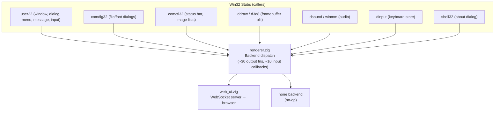

# FLTK GUI Backend: Renderer Abstraction & Native Pipeline

## Goal

Create a native GUI alternative to the WebSocket-based web UI by:
1. Abstracting `renderer.zig` into a proper backend interface
2. Building an FLTK backend that maps all Win32 GUI elements into native FLTK widgets

This gives Zine a **zero-dependency native GUI** — no browser needed, lower latency, and direct framebuffer blitting via FLTK's `Fl_Image`.

---

## Current Architecture



### Key design points

- **`renderer.zig`** owns all shared state: framebuffer, keyboard state, edit text buffer, clipboard, cached JSON for reconnection, and input callback function pointers.
- **`web_ui.zig`** is the only backend. It serializes everything to JSON and pushes over WebSocket. The browser renders via `<canvas>` + DOM elements styled with `win2k.css`.
- **Backend switching** is already a `switch (active_backend)` pattern in `pushFrame()`, `pushMessage()`, `pushAudio()`, and `init()`.
- **Input callbacks** (`on_command`, `on_resize`, `on_key_event`, `on_close`, etc.) are set by Win32 stubs at init time. Backends call these when user input arrives.

---

## Proposed Changes

### Phase 1: Renderer Abstraction

Extract the backend-specific dispatching into a clean interface. The current pattern already switches on `active_backend` in 4 functions — generalize this.

#### [MODIFY] [renderer.zig](file:///home/maci/Desktop/Projects/zine/src/gui/renderer.zig)

Expand the `Backend` enum and refactor dispatch functions:

```diff
 pub const Backend = enum {
     web_ui,
+    fltk,
     none,
 };

 // In pushFrame(), pushMessage(), pushAudio(), init():
 // Add .fltk => fltk_ui.xxx() branches
```

The ~25 typed output functions (`setTitle`, `showMessageBox`, `setMenu`, etc.) currently build JSON strings and call `pushMessage()`. For the FLTK backend, these need to call FLTK-native operations instead. Two design options:

**Option A — Keep JSON path, parse in FLTK backend:** Minimal changes to renderer.zig. The FLTK backend receives JSON like web_ui but interprets it with native widgets. Simpler to implement but adds unnecessary serialization overhead.

**Option B — Add direct dispatch per function (recommended):** Each typed output function switches on backend. For `web_ui`, it builds JSON and calls `pushMessage()`. For `fltk`, it calls the FLTK backend's typed function directly. This avoids JSON round-tripping for the native path.

```diff
 pub fn setTitle(title: []const u8) void {
     // Cache for reconnect
     ...
-    pushMessage(json);
+    switch (active_backend) {
+        .web_ui => web_ui.pushMessage(json),
+        .fltk => fltk_ui.setTitle(title),
+        .none => {},
+    }
 }
```

This means each of the ~25 output functions in `renderer.zig` gains a 3-way switch. The JSON building only runs for `.web_ui`.

#### [NEW] [fltk_ui.zig](file:///home/maci/Desktop/Projects/zine/src/gui/fltk_ui.zig)

New backend module, parallel to `web_ui.zig`. Implements all typed output functions plus the event loop.

---

### Phase 2: Zig-FLTK Bindings

FLTK is a C/C++ library. We need Zig bindings. Options:

1. **cfltk** (recommended) — A C wrapper around FLTK that's easy to bind from Zig via `@cImport`. Already exists at [github.com/MoAlyousef/cfltk](https://github.com/MoAlyousef/cfltk) with Zig bindings at [github.com/MoAlyousef/zfltk](https://github.com/MoAlyousef/zfltk).
2. **Raw FLTK C++ with `extern "C"` wrappers** — More control but more work.

> [!IMPORTANT]
> **Decision needed:** Should we use the existing `zfltk` package or vendor our own minimal C bindings? `zfltk` brings the whole FLTK widget set but adds a dependency. A minimal hand-rolled binding would only wrap the ~15 FLTK classes we actually need.

#### [NEW] fltk binding approach (build.zig changes)

```diff
 // In build.zig, for native builds:
+if (use_fltk) {
+    exe.addCSourceFile(.{ .file = "src/gui/fltk_bridge.c" });
+    exe.linkSystemLibrary("cfltk");
+    exe.linkSystemLibrary("fltk");
+}
```

Or with zfltk as a Zig dependency:
```diff
+const zfltk = b.dependency("zfltk", .{ .target = target, .optimize = optimize });
+exe.root_module.addImport("zfltk", zfltk.module("zfltk"));
```

---

### Phase 3: Win32 → FLTK Widget Mapping

This is the core of the work. Every renderer output function maps to FLTK operations:

#### Window Chrome

| Renderer function | Web UI | FLTK equivalent |
|---|---|---|
| `setTitle(title)` | `set_title` JSON → DOM | `Fl_Window::label(title)` |
| `setWindowPos(cx,cy,cW,cH)` | `set_window_pos` JSON → CSS | `Fl_Window::resize(x,y,w,h)` |
| `setResolution(w,h)` | `set_resolution` JSON → canvas | Resize `Fl_RGB_Image` / pixel buffer |
| `setIcon(json)` | Favicon/title bar icon | `Fl_Window::icon()` with `Fl_RGB_Image` |

#### Framebuffer (DirectDraw/D3D surface)

| Renderer function | Web UI | FLTK equivalent |
|---|---|---|
| `pushFrame()` | Binary WS message → canvas `putImageData` | Copy `global_framebuf` into `Fl_RGB_Image`, call `Fl_Box::image()` + `redraw()` |

FLTK framebuffer blitting approach:
```
Fl_Double_Window (main window)
  └── Fl_Box (canvas area)
       └── Fl_RGB_Image(global_framebuf, w, h, 4)  // RGBA
```
On each `pushFrame()`, create a new `Fl_RGB_Image` from the raw buffer and assign it to the box widget.

#### Menus

| Renderer function | Web UI | FLTK equivalent |
|---|---|---|
| `setMenu(json)` | JSON → DOM menu bar | Parse menu JSON, build `Fl_Menu_Bar` items via `add()` |
| `enableMenuItem(id, en)` | JSON → DOM class toggle | `Fl_Menu_Bar::mode(idx, FL_MENU_INACTIVE)` |
| `checkMenuItem(id, ck)` | JSON → checkbox icon | `Fl_Menu_Bar::mode(idx, FL_MENU_TOGGLE\|FL_MENU_VALUE)` |

The menu JSON format (from `menu.json` / PE resource parsing) is:
```json
{"type":"set_menu","items":[{"label":"&File","children":[{"label":"&New","id":40001},...]},...]}
```

The FLTK backend parses this and calls `menu_bar->add("File/New", 0, menu_callback, (void*)40001)`. On click, the callback fires `renderer.on_command(id)`.

#### Edit Control (textarea)

| Renderer function | Web UI | FLTK equivalent |
|---|---|---|
| `showEditControl(multiline)` | Show `<textarea>` | Create `Fl_Text_Editor` + `Fl_Text_Buffer` |
| `resizeEditControl(x,y,w,h)` | CSS resize textarea | `editor->resize(x,y,w,h)` |
| `setEditFont(face,pt,b,i)` | CSS font on textarea | `editor->textfont(FL_COURIER)`, `editor->textsize(pt)` |
| `setEditSelection(s,e)` | JS `setSelectionRange` | `editor->buffer()->select(s,e)` |
| `replaceEditSelection(text)` | JS selection replace | `buffer->replace_selection(text)` |
| `editUndo()` | JS `execCommand('undo')` | `Fl_Text_Buffer::undo()` |
| `editScrollCaret()` | JS `scrollIntoView` | `editor->show_insert_position()` |
| `setEditText(text)` | JSON message + sync | `buffer->text(text)` |

Text sync back to `renderer.edit_text_data`:
- Attach a `modify_callback` on the `Fl_Text_Buffer` that calls `renderer.setEditTextFromSlice(buffer->text())` on changes.

#### Dialogs

| Renderer function | Web UI | FLTK equivalent |
|---|---|---|
| `showMessageBox(title, text)` | JSON → DOM modal | `fl_message_title(title); fl_alert(text)` |
| `showDialog(json)` | JSON → custom DOM dialog | Create `Fl_Window` with controls parsed from JSON |
| `closeDialog()` | JSON → hide overlay | `dialog_window->hide()` |
| `openFileDialog(filters, is_save)` | JSON → file picker | `Fl_Native_File_Chooser` |
| `openFontDialog(face,pt,b,i)` | JSON → font picker | Custom `Fl_Window` with font selection (FLTK has no built-in font dialog) |

#### Status Bar

| Renderer function | Web UI | FLTK equivalent |
|---|---|---|
| `setStatusBarParts(count)` | JSON → DOM status bar | Create `Fl_Group` with N `Fl_Box` children at window bottom |
| `setStatusBarText(part, text)` | JSON → DOM text | `status_boxes[part]->label(text)` |

#### Controls (Dialog Children)

| Renderer function | Web UI | FLTK equivalent |
|---|---|---|
| `showControls(json)` | JSON → DOM elements | Parse JSON, create `Fl_Button`, `Fl_Check_Button`, `Fl_Input`, `Fl_Box` etc. |
| `addControl(class, id, x, y, w, h, style, text)` | JSON → DOM child | Map class name → FLTK widget (see table below) |
| `updateControlText(id, text)` | JSON → DOM innerHTML | Find widget by ID, set `label(text)` or `value(text)` |

Win32 control class → FLTK widget mapping:

| Win32 class | FLTK widget |
|---|---|
| `BUTTON` (push) | `Fl_Button` |
| `BUTTON` (`BS_CHECKBOX`) | `Fl_Check_Button` |
| `BUTTON` (`BS_RADIOBUTTON`) | `Fl_Round_Button` |
| `BUTTON` (`BS_GROUPBOX`) | `Fl_Group` with frame |
| `STATIC` | `Fl_Box` |
| `EDIT` | `Fl_Input` / `Fl_Multiline_Input` |
| `COMBOBOX` | `Fl_Choice` |
| `LISTBOX` | `Fl_Browser` |
| `msctls_statusbar32` | `Fl_Box` (bottom bar) |
| `SysTabControl32` | `Fl_Tabs` |
| `SysListView32` | `Fl_Table` |
| `SysTreeView32` | `Fl_Tree` |
| `msctls_progress32` | `Fl_Progress` (FLTK 1.4) or custom |
| `SysHeader32` | Column headers in `Fl_Table` |
| `msctls_trackbar32` | `Fl_Slider` |

#### Context Menu

| Renderer function | Web UI | FLTK equivalent |
|---|---|---|
| `showContextMenu(x, y, items_json)` | JSON → DOM popup | `Fl_Menu_Button` popup at (x,y) |

#### Audio

| Renderer function | Web UI | FLTK equivalent |
|---|---|---|
| `setVolume(linear)` | JSON → Web Audio gain | OS audio mixer or SDL_mixer |
| `setAudioFormat(rate, ch, bps)` | JSON → AudioContext config | Configure audio backend |
| `pushAudio(data)` | Binary WS → AudioWorklet | Write PCM to audio stream |

> [!WARNING]
> FLTK has no built-in audio. Audio needs a separate solution: **PortAudio**, **SDL2_audio**, **PulseAudio** direct, or **miniaudio** (single-header C library). This is orthogonal to the FLTK GUI work and can be deferred or implemented separately.

#### Clipboard

| Renderer function | Web UI | FLTK equivalent |
|---|---|---|
| `setClipboard(text)` | JSON → `navigator.clipboard` | `Fl::copy(text, len, 1)` (clipboard 1 = system) |

Sync from system clipboard: `Fl::paste(*widget, 1)` with `FL_PASTE` event handler.

#### Input (Keyboard/Mouse)

FLTK event loop → renderer callbacks:

| FLTK event | Renderer callback |
|---|---|
| `FL_KEYBOARD` | `renderer.on_key_event(vk_code, true)` |
| `FL_KEYUP` | `renderer.on_key_event(vk_code, false)` |
| `FL_SHORTCUT` | Map `Fl::event_key()` → VK code |
| Window close (`FL_CLOSE` via event handler) | `renderer.on_close()` |
| Window resize (`FL_RESIZE` / `resize()` override) | `renderer.on_resize(cw, ch, SIZE_RESTORED)` |
| Menu item click | `renderer.on_command(menu_id)` |
| Dialog cancel (Escape / close button) | `renderer.on_cancel_dialog()` |
| Context menu select | `renderer.on_context_menu_select(id)` |

Key mapping: FLTK uses `FL_Left`, `FL_Right`, `FL_F+n` etc. Map these to Win32 VK codes (0x25, 0x27, 0x70+n) same as `web_ui.zig::mapBrowserKey()` does for browser keys.

---

### Phase 4: Build System & Backend Selection

#### [MODIFY] [build.zig](file:///home/maci/Desktop/Projects/zine/build.zig)

```diff
+const use_fltk = b.option(bool, "fltk", "Enable FLTK native GUI backend") orelse false;
+
 // In native exe setup:
+if (use_fltk) {
+    // Link FLTK via zfltk dependency or system library
+    exe.root_module.addImport("fltk", fltk_dep.module("fltk"));
+}
```

#### [MODIFY] [renderer.zig](file:///home/maci/Desktop/Projects/zine/src/gui/renderer.zig)

Use comptime or build option to conditionally import `fltk_ui.zig`:

```diff
+const fltk_ui = if (@hasDecl(@import("root"), "use_fltk"))
+    @import("fltk_ui.zig")
+else
+    struct {}; // no-op when FLTK not compiled in
```

#### [MODIFY] [main.zig](file:///home/maci/Desktop/Projects/zine/src/main.zig)

Add `--fltk` CLI flag to select backend at startup:

```diff
+if (has_fltk_flag) {
+    renderer.active_backend = .fltk;
+}
```

---

### Phase 5: Event Loop Integration

The web_ui backend runs its own HTTP server thread. The FLTK backend needs FLTK's event loop (`Fl::run()` or `Fl::wait()`), which must run on the main thread (FLTK requirement on most platforms).

**Threading model:**

```
Main thread:   FLTK event loop (Fl::wait() in a loop)
Worker thread: x86 execution (PE loader + interpreter/native jump)
                └── calls renderer.setTitle(), pushFrame(), etc.
                    └── these must be thread-safe (FLTK is NOT thread-safe)
```

Solution: Use `Fl::awake(callback, data)` to post work to the FLTK main thread from the worker thread. All FLTK widget mutations happen in the `awake` callback, serialized on the main thread.

```
Worker thread calls renderer.setTitle("Hello")
  → fltk_ui.setTitle("Hello")
    → enqueue {.set_title, "Hello"} into a thread-safe ring buffer
    → Fl::awake()  (wakes the main loop)

Main thread Fl::wait() returns
  → drain ring buffer, apply each operation to FLTK widgets
```

This is the same pattern the web_ui uses (WebSocket send from worker thread; browser UI updates happen on the browser's main thread).

---

## Win2K Theming Strategy

FLTK's visual model was designed around the same Win95/2000-era 3D border system
that `win2k.css` replicates. This makes it the easiest toolkit to theme accurately.

### Level 1: System Colors (trivial, ~10 lines)

Map the CSS `:root` variables directly to FLTK system colors at startup:

| CSS variable | Hex | FLTK call |
|---|---|---|
| `--sys-face` | `#D4D0C8` | `Fl::set_color(FL_BACKGROUND_COLOR, 0xD4D0C8)` |
| `--sys-window` | `#FFFFFF` | `Fl::set_color(FL_BACKGROUND2_COLOR, 0xFFFFFF)` |
| `--sys-text` | `#000000` | `Fl::set_color(FL_FOREGROUND_COLOR, 0x000000)` |
| `--sys-sel` | `#0A246A` | `Fl::set_color(FL_SELECTION_COLOR, 0x0A246A)` |
| `--sys-gray-text` | `#808080` | `Fl::set_color(FL_INACTIVE_COLOR, 0x808080)` |

This alone gives the correct Win2K color palette across all widgets.

### Level 2: Custom Box Types (moderate, ~4 functions × ~30 lines each)

FLTK's `Fl::set_boxtype()` lets us register custom drawing functions that
replace the default 3D look globally. The CSS 3D border model maps directly:

```
CSS raised:  border-color: Hilight DkShadow DkShadow Hilight
             box-shadow:   inset -1px -1px Shadow, inset 1px 1px Light

FLTK custom: fl_color(Hilight); fl_line(TL edges)
             fl_color(DkShadow); fl_line(BR edges)
             fl_color(Light); fl_line(inner TL)
             fl_color(Shadow); fl_line(inner BR)
```

| Custom box type | Replaces | CSS equivalent |
|---|---|---|
| `WIN2K_UP_BOX` | `FL_UP_BOX` | `.win2k-button` raised border |
| `WIN2K_DOWN_BOX` | `FL_DOWN_BOX` | `.win2k-edit` sunken border |
| `WIN2K_THIN_UP_BOX` | `FL_THIN_UP_BOX` | `.win2k-titlebar-btn` |
| `WIN2K_FRAME` | `FL_UP_FRAME` | `.win2k-window` outer frame |

Register globally to apply to all widgets at once:
```c
Fl::set_boxtype(FL_UP_BOX, win2k_up_box, 2, 2, 4, 4);
Fl::set_boxtype(FL_DOWN_BOX, win2k_down_box, 2, 2, 4, 4);
```

### Level 3: Custom-Drawn Elements (~200 lines total)

Some Win2K elements need manual drawing:

| Element | Approach | Lines |
|---|---|---|
| Title bar gradient (`#0A246A → #A6CAF0`) | Loop drawing vertical lines with interpolated RGB in `draw()` override | ~20 |
| Caption buttons (min/max/close glyphs) | Custom `Fl_Button` subclass with `draw()` rendering the glyph shapes | ~50 each |
| Taskbar (Start + task buttons + tray) | Custom `Fl_Group` at window bottom with child `Fl_Button` widgets | ~200 |
| Font: 11px MS Sans Serif/Tahoma | `Fl::set_font(FL_HELVETICA, "Tahoma"); Fl::set_fontsize(11);` | 2 |

### What comes free (zero effort)

These FLTK defaults already match Win2K out of the box:

- **Scrollbars** — 16px with arrow buttons, classic 3D thumb
- **`Fl_Tabs`** — Matches `SysTabControl32` appearance
- **`Fl_Check_Button` / `Fl_Round_Button`** — Sunken checkbox/radio with checkmark
- **`Fl_Menu_Bar`** — Raised menu items with popup dropdowns
- **`Fl_Input` / `Fl_Text_Editor`** — Sunken edit controls with white background
- **Focus dotted rectangle** — Built-in `fl_focus_rect()`
- **3D raised/sunken borders** — The entire `FL_UP_BOX`/`FL_DOWN_BOX` system

---

## User Review Required

> [!IMPORTANT]
> **FLTK binding strategy:** Should we use the existing [zfltk](https://github.com/MoAlyousef/zfltk) package or write minimal hand-rolled C bindings? zfltk is more complete but adds a vendored C++ dependency (~2MB compiled).

> [!IMPORTANT]
> **Audio backend:** FLTK has no audio. Should we defer audio entirely and focus on GUI-only, or add a lightweight audio library like **miniaudio** (single C header, no dependencies) alongside FLTK?

> [!WARNING]
> **Font dialog:** FLTK has no built-in font chooser dialog. We'd need to build a custom one using `Fl_Browser` + `Fl::set_fonts()` enumeration. This is additional work beyond the direct mapping.

---

## Verification Plan

### Automated Tests

Since this is a GUI-focused change, automated unit testing is limited but possible:

1. **Build verification** — The FLTK backend must compile without errors:
   ```bash
   zig build -Dfltk=true
   ```

2. **Existing x86 tests must still pass** (no regressions in non-GUI code):
   ```bash
   zig build test
   ```

3. **Backend dispatch test** — A new test in `renderer.zig` that sets `active_backend = .none` and calls all output functions, verifying no crashes. (Already implicitly tested since `.none` exists.)

### Manual Verification

Since this is fundamentally a GUI change, the main verification is visual:

1. **Launch with FLTK backend** and a known PE binary that exercises:
   - Window creation with title → verify FLTK window appears with correct title
   - Menu bar rendering → verify FLTK menu matches web UI menu
   - Framebuffer rendering (DirectDraw game) → verify pixel-correct display
   - Message box dialogs → verify `fl_alert` appears
   - Edit control (text editor apps) → verify `Fl_Text_Editor` appears and syncs text
   - File open dialog → verify `Fl_Native_File_Chooser` works
   - Status bar → verify bottom bar renders

2. **Compare side-by-side** with the web UI to verify visual parity.

> [!NOTE]
> I'd appreciate your guidance on which specific PE binaries you'd like to test against, and whether you have FLTK already installed on the system or we need to handle building it from source.
