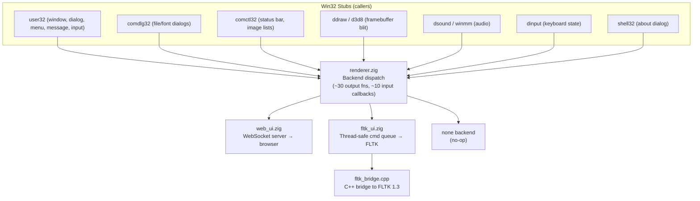

# FLTK GUI Backend: Renderer Abstraction & Native Pipeline

## Goal

Create a native GUI alternative to the WebSocket-based web UI by:
1. Abstracting `renderer.zig` into a proper backend interface
2. Building an FLTK backend that maps all Win32 GUI elements into native FLTK widgets

This gives Zine a **zero-dependency native GUI** — no browser needed, lower latency, and direct framebuffer blitting via FLTK's `Fl_Image`.

---

## Current Architecture



### Key design points

- **`renderer.zig`** owns all shared state: framebuffer, keyboard state, edit text buffer, clipboard, cached JSON for reconnection, and input callback function pointers.
- **`web_ui.zig`** serializes everything to JSON and pushes over WebSocket.
- **`fltk_ui.zig`** uses a thread-safe command queue to forward calls to the FLTK event loop thread.
- **`fltk_bridge.cpp`** is a C++ bridge (~1400 lines) providing C-callable wrappers around FLTK 1.3 widgets.
- **Backend switching** is a `switch (active_backend)` in every output function (`.web_ui`, `.fltk`, `.none`).
- **Input callbacks** (`on_command`, `on_resize`, `on_key_event`, `on_close`, etc.) are set by Win32 stubs at init time. Backends call these when user input arrives.

---

## Implementation Status

### Phase 1: Renderer Abstraction ✅ COMPLETE

- `Backend` enum has `.web_ui`, `.fltk`, `.none` variants
- All ~25 output functions have a 3-way switch dispatch
- JSON building only runs on `.web_ui` path

### Phase 2: FLTK Bindings ✅ COMPLETE

**Decision: Hand-rolled C++ bridge** instead of zfltk.

Rationale: System has FLTK 1.3.11 shared libs, but zfltk requires cfltk (targeting FLTK 1.4) built via CMake. A C++ bridge (`fltk_bridge.cpp`, ~1400 lines) compiled directly by Zig's build system is simpler and avoids the cfltk dependency chain.

#### Files

| File | Purpose |
|---|---|
| [`fltk_bridge.h`](../src/gui/fltk_bridge.h) | C header — 15 bridge functions, 5 event type constants |
| [`fltk_bridge.cpp`](../src/gui/fltk_bridge.cpp) | C++ implementation: `ZineWindow` subclass, `Fl_RGB_Image` framebuffer, JSON menu parser, Win2K colors, keyboard→VK mapping |
| [`fltk_ui.zig`](../src/gui/fltk_ui.zig) | Zig backend: conditional `@cImport`, thread-safe command queue, event callback dispatch |

#### Build system (`build.zig`)

```bash
zig build -Dfltk=true
```

The `-Dfltk=true` option:
- Compiles `fltk_bridge.cpp` with `-std=c++11 -fno-exceptions -I/usr/include/fltk1.3`
- Links system FLTK 1.3 (`/usr/lib/fltk1.3/`) and X11 dependencies
- Passes `build_options.use_fltk` to Zig source for conditional compilation

> **Note:** FLTK is currently supported on the x86 (default) target only.

#### CLI flag (`main.zig`)

```bash
zig-out/bin/zine --fltk -i path/to/gui_app.exe
```

### Phase 3: Win32 → FLTK Widget Mapping — PARTIALLY COMPLETE

#### Implemented ✅

| Renderer function | FLTK bridge call |
|---|---|
| `init()` | `fltk_init()` — creates `Fl_Double_Window`, `Fl_Menu_Bar`, `Fl_Box` canvas, spawns event loop thread |
| `setTitle(title)` | `fltk_set_title()` → `Fl_Window::copy_label()` |
| `setWindowPos(cx,cy,cW,cH)` | `fltk_resize_window()` → `Fl_Window::resize()` |
| `setResolution(w,h)` | `fltk_resize_window()` |
| `pushFrame()` | `fltk_set_framebuf()` → copy BGRA to `Fl_RGB_Image`, assign to canvas `Fl_Box` |
| `setMenu(json)` | `fltk_set_menu_json()` — state-machine JSON parser builds `Fl_Menu_Bar` items |
| `enableMenuItem(id, en)` | `fltk_enable_menu_item()` → `Fl_Menu_Bar::mode()` |
| `checkMenuItem(id, ck)` | `fltk_check_menu_item()` → `FL_MENU_TOGGLE`/`FL_MENU_VALUE` |
| `showMessageBox(title, text)` | `fltk_alert()` → `fl_message_title()` + `fl_alert()` |
| Keyboard events | `ZineWindow::handle()` maps FLTK key codes → Win32 VK codes |
| Close event | `ZineWindow::handle(FL_CLOSE)` → `renderer.on_close()` |
| Resize event | `ZineWindow::resize()` → `renderer.on_resize()` |
| Menu clicks | `menu_cb()` → `renderer.on_command(id)` |

#### Remaining Stubs 🔲

Status as of 2026-08: most of this table shipped (see `src/gui/fltk_bridge.h` and
[`STATUS.md`](STATUS.md)); only audio remains a stub.

| Feature | FLTK approach | Status |
|---|---|---|
| Edit control | `Fl_Text_Editor` + `Fl_Text_Buffer` | ✅ Done (`fltk_edit_*` bridge functions) |
| Status bar | `Fl_Group` with N `Fl_Box` children | ✅ Done (`msctls_statusbar32` handling) |
| File dialog | `Fl_Native_File_Chooser` | ✅ Done (`fltk_open_file_dialog`) |
| Font dialog | Custom `Fl_Window` (FLTK has no built-in) | ✅ Done (`fltk_open_font_dialog`) |
| Context menu | `Fl_Menu_Button` popup | ✅ Done (`fltk_show_context_menu`) |
| Custom dialogs | `Fl_Window` + parsed controls | ✅ Done (`fltk_show_dialog`/`fltk_add_dialog_item`/...) |
| Clipboard | `Fl::copy()` / `Fl::paste()` | ✅ Done (`fltk_set_clipboard`) |
| Window icon | `Fl_Window::icon()` with `Fl_RGB_Image` | ✅ Done (`fltk_set_icon`) |
| Print dialog | Custom `Fl_Window` form | ✅ Done (`fltk_open_print_dialog`) |
| Find/Replace dialog | Custom modeless `Fl_Window` | ✅ Done (`fltk_open_find_dialog`) |
| Page setup dialog | Custom `Fl_Window` form | ✅ Done (`fltk_open_page_setup_dialog`) |
| Color chooser | `Fl_Color_Chooser` | ✅ Done (`fltk_open_color_dialog`) |
| Audio | Needs external lib (miniaudio, PortAudio) | 🔲 Stub |

### Phase 4: Build System ✅ COMPLETE

See Phase 2 above — integrated into `build.zig`.

### Phase 5: Event Loop Integration ✅ COMPLETE

**Threading model:**

```
Worker thread:  x86 execution calls renderer functions
                  → fltk_ui enqueues Command into ring buffer
                  → calls fltk_awake() to wake FLTK thread

FLTK thread:    spawned in init(), runs Fl::check() + drainQueue() loop
                  → applies widget mutations from queue
                  → forwards FLTK events to renderer callbacks
```

The `Command` union supports: `set_title`, `set_framebuf`, `resize_window`, `set_menu`, `show_message_box`, `set_resolution`, `redraw`.

---

## Win2K Theming Strategy

FLTK's visual model was designed around the same Win95/2000-era 3D border system
that `win2k.css` replicates. The bridge sets Win2K system colors at init:

| CSS variable | Hex | Status |
|---|---|---|
| `--sys-face` (`FL_BACKGROUND_COLOR`) | `#D4D0C8` | ✅ Set in `fltk_init()` |
| `--sys-window` (`FL_BACKGROUND2_COLOR`) | `#FFFFFF` | ✅ Set |
| `--sys-text` (`FL_FOREGROUND_COLOR`) | `#000000` | ✅ Set |
| `--sys-sel` (`FL_SELECTION_COLOR`) | `#0A246A` | ✅ Set |
| `--sys-gray-text` (`FL_INACTIVE_COLOR`) | `#808080` | ✅ Set |

Uses `Fl::scheme("none")` for the classic look closest to Win2K.

### Future Theming Work

| Element | Approach |
|---|---|
| Custom 3D box types | `Fl::set_boxtype()` with custom draw functions |
| Title bar gradient | Custom `draw()` override with interpolated RGB |
| Caption button glyphs | Custom `Fl_Button` subclass |
| Font: MS Sans Serif/Tahoma | `Fl::set_font(FL_HELVETICA, "Tahoma")` |

---

## Verification Results

| Check | Result |
|---|---|
| `zig build -Dfltk=true` | ✅ Clean build |
| `zig build` (default x86, no FLTK) | ✅ No regressions |
| `zig build test` | ✅ All tests pass |
| GUI smoke suite (`tests/fltk_smoke.sh`, 20 self-exiting apps under Xvfb) | ✅ 20 PASS / 0 FAIL (see [`STATUS.md`](STATUS.md)) |

### Collateral Fixes

Two pre-existing x86_64 build issues were fixed:

1. **`msvcrt/math.zig:stub_ftol_x64`** — Invalid `fistpll` asm on x86_64. Replaced with plain Zig stub.
2. **`msvcrt/misc.zig` + `io.zig`** — `VaListX86_64` is a struct (not a pointer), so `@intFromPtr(ap)` failed. Added `va_list_to_usize()` helper.
